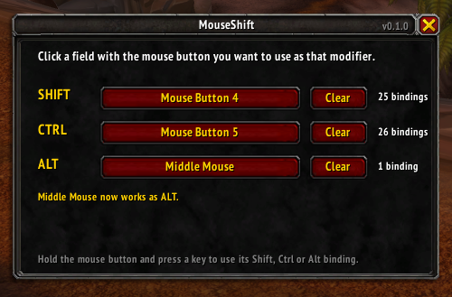
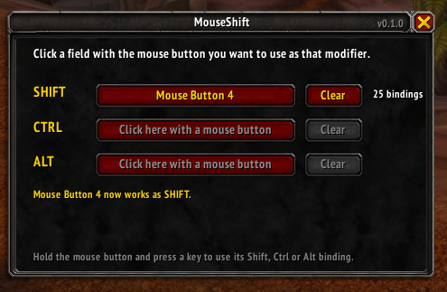

<h3>MouseShift</h3>

Bind Shift, Ctrl and Alt to your mouse buttons in World of Warcraft.
&nbsp;&nbsp;

&nbsp;&nbsp;

[CurseForge](https://www.curseforge.com/wow/addons/mouseshift) · [Wago](https://addons.wago.io/addons/mouseshift) · [WoWInterface](https://www.wowinterface.com/downloads/info27280-MouseShift.html) · [Discord](https://discord.gg/cbmqVcNq7) · [Releases](https://github.com/mikebronka/MouseShift/releases) 

> **Early version.** MouseShift is new. If something does not work, please [open an issue](https://github.com/mikebronka/MouseShift/issues/new/choose).

Hold the button under your thumb, press `2`, and the game does whatever you have on `SHIFT-2`. No awkward key stretches, twice as many bindings within reach of your left hand, and no external key remapping software.

## Features

- Turn any extra mouse button into SHIFT, CTRL or ALT. Use one, two or all three.
- Hold two of them together for combinations such as CTRL-SHIFT.
- Assign a button by clicking it. No need to know whether your thumb button is Button 4 or Button 5.
- Works with MMO mice whose side buttons send keyboard keys, such as the Razer Naga: any key can be a modifier too.
- Works in combat.
- Uses your existing SHIFT, CTRL and ALT bindings. Nothing to rebind.
- Works with the default action bars and with action bar addons.
- No changes to your interface. One small window, opened only when you need it.
- Retail and WoW Forever.

## Installation

### Addon manager

Search for **MouseShift** in the CurseForge app, the Wago app or WowUp.

- [CurseForge](https://www.curseforge.com/wow/addons/mouseshift)
- [Wago](https://addons.wago.io/addons/mouseshift)
- [WoWInterface](https://www.wowinterface.com/downloads/info27280-MouseShift.html)

### Manual

1. Download `MouseShift-vX.Y.Z.zip` from the latest [release](https://github.com/mikebronka/MouseShift/releases/latest). Do not use the "Source code" files GitHub adds to every release: their folder has the wrong name and the game will not load it.
2. Extract it into your AddOns folder:
   - Retail: `World of Warcraft\_retail_\Interface\AddOns\`
   - WoW Forever: `World of Warcraft\_forever_\Interface\AddOns\`
3. You should end up with `Interface\AddOns\MouseShift\MouseShift.toc`.
4. Restart the game and make sure MouseShift is enabled in the AddOns list.

## Usage

1. Type `/mouseshift` to open the configuration window. You can also open it from the addons button next to the minimap, or from Options > AddOns > MouseShift.
2. Click the SHIFT field with the mouse button you want to use as SHIFT. To use a key instead, left-click the field and press the key.
3. Do the same for CTRL and ALT if you want them.
4. Close the window. Done.

Hold two assigned buttons together to reach your CTRL-SHIFT, ALT-SHIFT or ALT-CTRL bindings, or all three for ALT-CTRL-SHIFT.

### Commands

| Command | What it does |
| --- | --- |
| `/mouseshift` | Open or close the configuration window |
| `/mouseshift list` | Show which keys each layer uses |
| `/mouseshift reset` | Clear all mouse buttons |
| `/mouseshift help` | Show the commands |

The left and right mouse buttons cannot be used, because the game needs them for targeting and the camera. Escape, Enter, movement keys and the real Shift, Ctrl and Alt keys cannot be used either.

## Limitations

- **Macro conditions.** The game does not see a real SHIFT key, so macros using `[mod:shift]`, `[mod:ctrl]` or `[mod:alt]` will not react to the mouse button. The same applies to action bar paging on a modifier key.
- **Clicks are not changed.** MouseShift works on key bindings, so Shift-click in the interface (linking an item in chat, Shift-click casting on raid frames with Clique or the game's click bindings) still needs the real Shift key.
- **Movement keys are not mirrored.** Releasing the mouse button before a movement key would leave your character running.
- **Settings cannot be changed in combat.** The game blocks binding changes from addons during combat. Using MouseShift in combat works normally.

## FAQ

**Is this allowed?**
MouseShift only uses the game's own key binding system. It does not automate anything: one key press is still one action.

**The side buttons of my mouse type numbers or other keys.**
Many MMO mice, such as the Razer Naga, send keyboard keys from their side buttons. Left-click a field in the MouseShift window and press the side button: it becomes that modifier. A key used as a modifier no longer does its own action.

**My mouse button already does something in the game.**
MouseShift takes over that button while it is assigned. The configuration window tells you what was bound to it before.

## Reporting problems

Open an [issue](https://github.com/mikebronka/MouseShift/issues/new/choose). Please include the output of `/mouseshift` and any Lua errors.

Questions and feedback are welcome on [Discord](https://discord.gg/cbmqVcNq7).

## License

[MIT](LICENSE) © [Mike Bronka](https://www.mikebronka.com)
