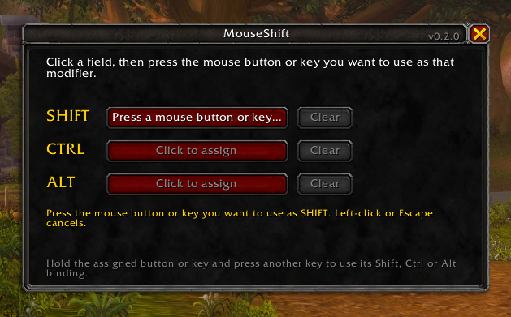
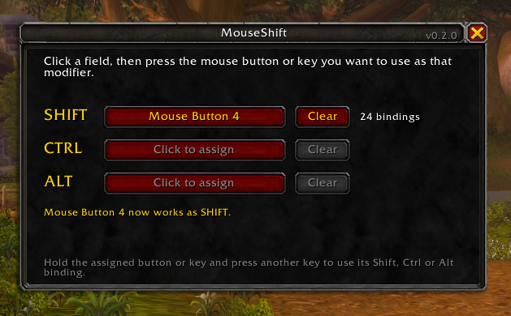

# Getting started

[Documentation](README.md) › Getting started

## 1. Install

**With an addon manager:** search for **MouseShift** in the CurseForge app, the Wago app or WowUp.

**By hand:**

1. Download `MouseShift-vX.Y.Z.zip` from the latest [release](https://github.com/mikebronka/MouseShift/releases/latest). Do not use the "Source code" files GitHub adds to every release: their folder has the wrong name and the game will not load it.
2. Extract it into your AddOns folder:
   - Retail: `World of Warcraft\_retail_\Interface\AddOns\`
   - WoW Forever: `World of Warcraft\_forever_\Interface\AddOns\`
3. You should end up with `Interface\AddOns\MouseShift\MouseShift.toc`.
4. Start the game and make sure MouseShift is enabled in the AddOns list.

## 2. Assign your buttons

Open the settings window in one of these ways:

- type `/mouseshift`
- click the addons button next to the minimap and choose MouseShift
- Options › AddOns › MouseShift

To assign a modifier:

1. Click the **Shift** field with the left mouse button. It now waits: *Press a mouse button or key…*
2. Press the mouse button you want to use as Shift, for example the thumb button. The cursor can be anywhere on the screen.
3. The field shows the button, and the window tells you what was bound to it before, if anything.

| Waiting | Assigned |
| --- | --- |
|  |  |

Repeat for **Ctrl** and **Alt** if you want them. Left-click or Escape cancels. **Clear** removes an assignment and the button gets its old keybind back.

Next to each field you can see how many of your keybinds that layer reaches, for example *24 bindings* for Shift.

## 3. Play

Hold the assigned button and press a key. The game does what you have on Shift plus that key. Release the button and the key is back to normal.

Hold two assigned buttons together for combined layers: Shift and Ctrl together reach your Ctrl-Shift keybinds.

## 4. Plan your keybinds

MouseShift uses the Shift, Ctrl and Alt keybinds you already have. If you have none yet, set them as usual in the game's key bindings menu or with your action bar addon: hold the real Shift and press the key.

Three ways to organise them that work well:

**One layer per purpose.** Plain keys for your rotation, Shift for cooldowns and defensives, Ctrl for utility and crowd control.

**Mirror by position.** Shift-1 is a stronger or longer version of 1: 1 is your fast heal, Shift-1 your big heal on the same key.

**Bars as layers.** Put action bar 1 on keys 1 to 6, action bar 2 on Shift-1 to Shift-6, action bar 3 on Ctrl-1 to Ctrl-6. Each bar is one layer of the same keys, which makes the setup easy to remember.

## 5. Commands

| Command | What it does |
| --- | --- |
| `/mouseshift` | Open or close the settings window |
| `/mouseshift list` | Show which keys each layer uses |
| `/mouseshift reset` | Clear all mouse buttons and keys |
| `/mouseshift help` | Show the commands |

## What cannot be assigned

The left and right mouse buttons, the mouse wheel, Escape, Enter, Print Screen, movement keys and the real Shift, Ctrl and Alt keys. A mouse button you use to turn the camera is refused too. This keeps the game playable whatever happens.

Next: [Healers](healers.md)
